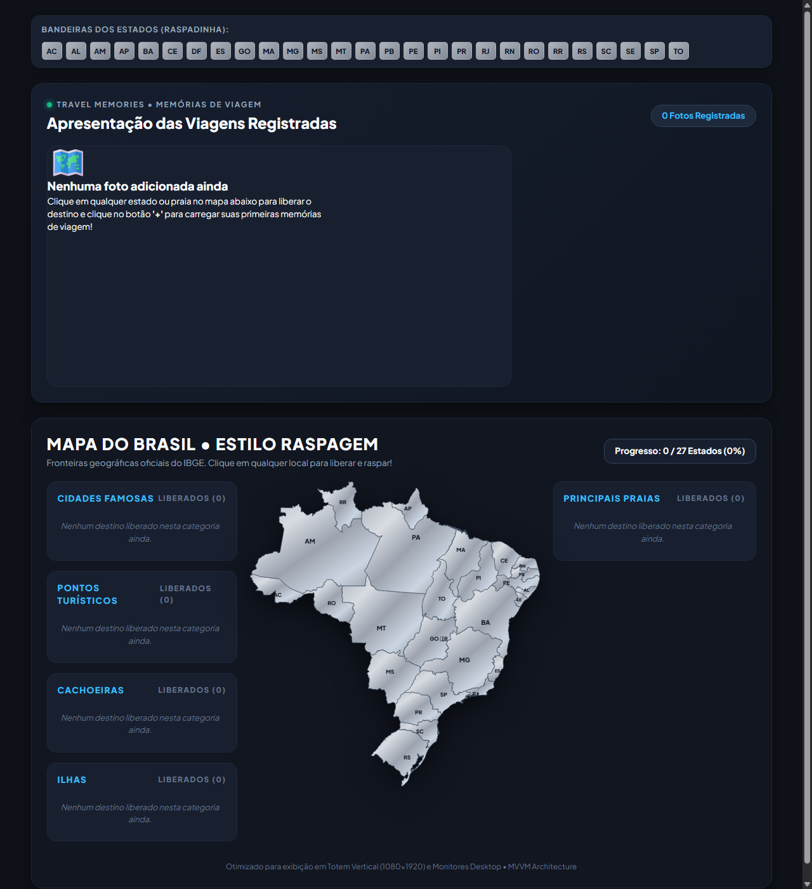
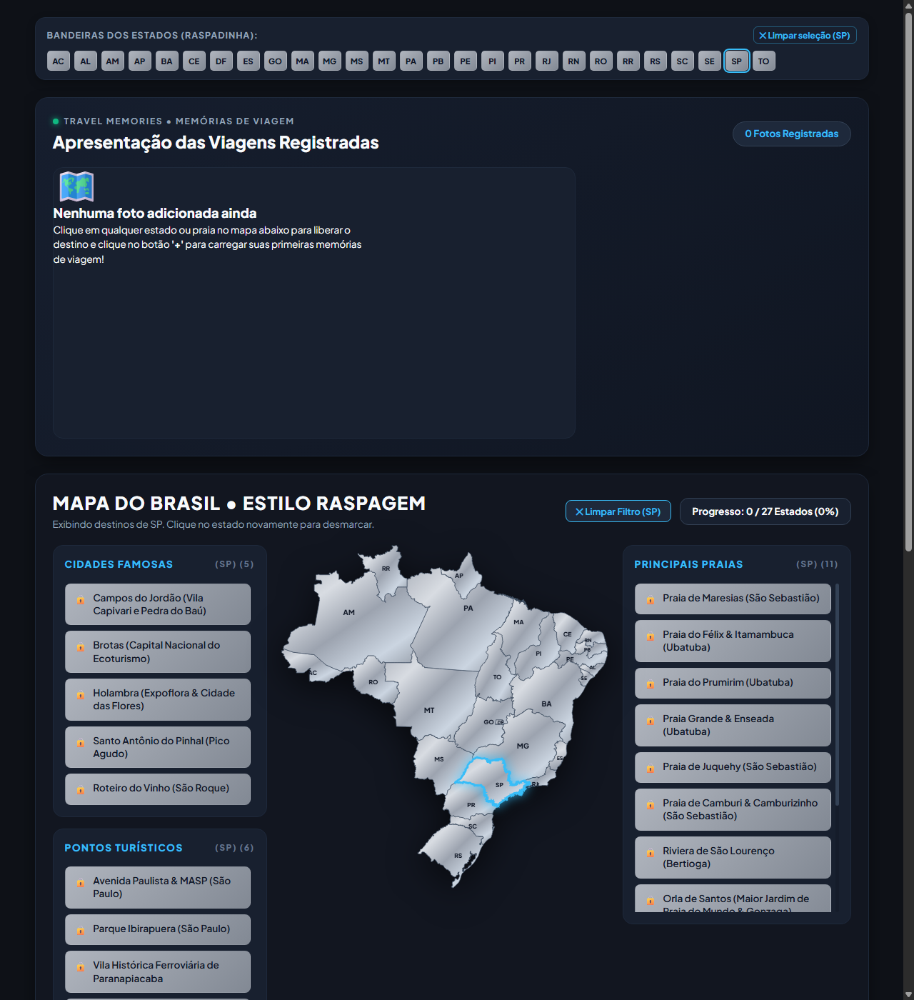
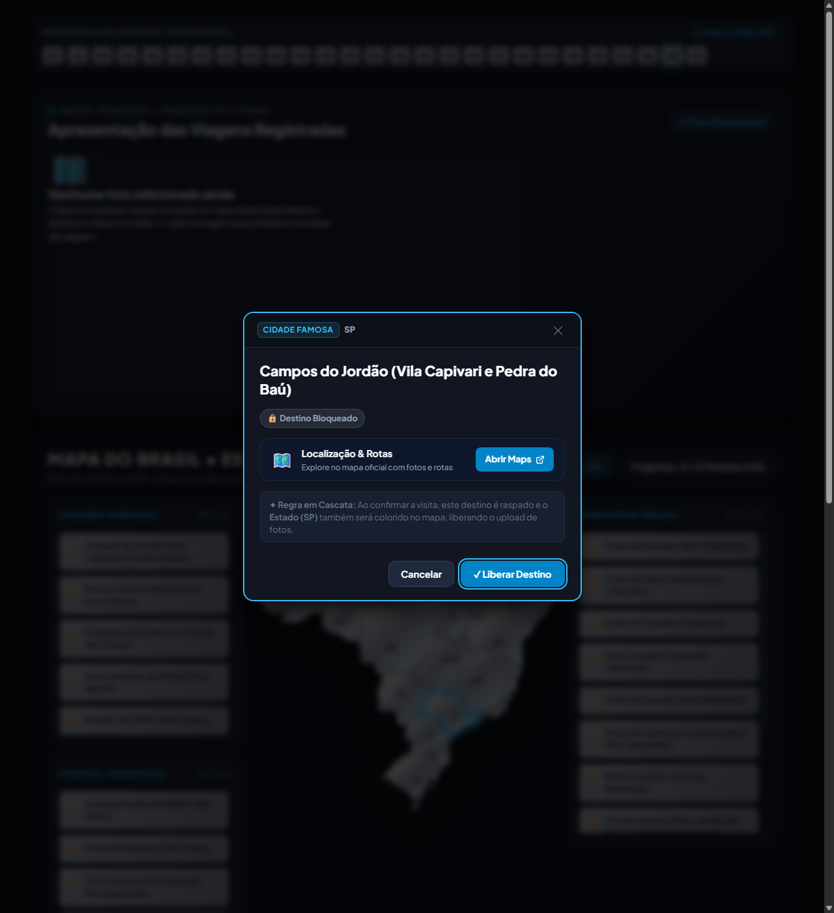
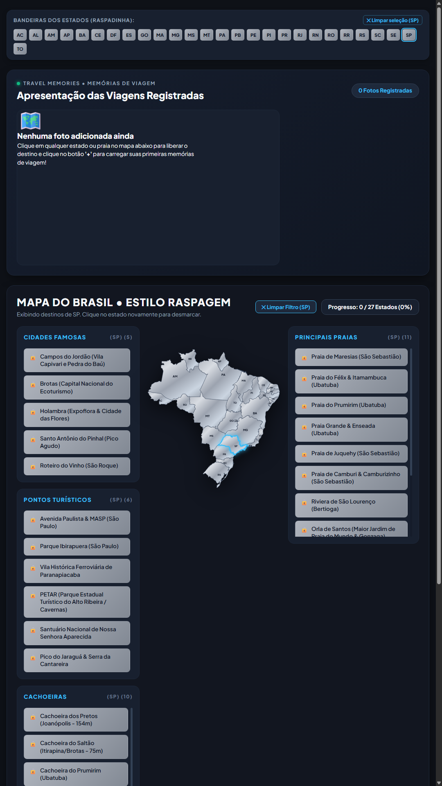
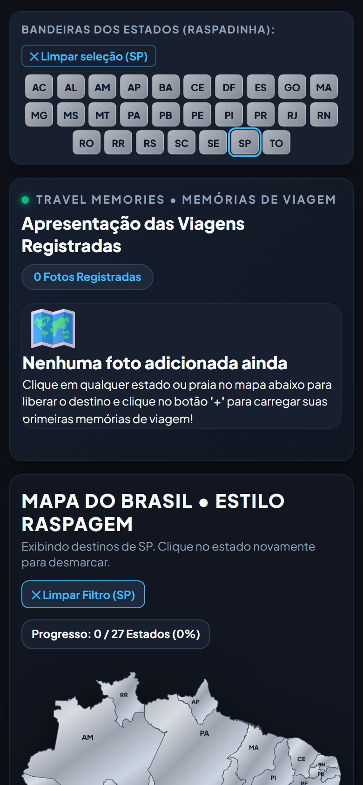

# Brazil Travel Scratch-Off Map & Memories Showcase 🇧🇷

[](https://react.dev/)
[](https://www.typescriptlang.org/)
[](https://vitejs.dev/)
[](https://vitest.dev/)
[](#-architecture-strict-mvvm-pattern)
[](#-accessibility-a11y)
[](docs/GOOGLE_SHEETS_INTEGRATION.md)

An interactive, high-performance web application inspired by luxury scratch-off travel posters, optimized for personal vertical displays (**1080×1920 Totem Kiosks**) and mobile smartphones. Built with **React 19**, **TypeScript 5**, **Vite 6**, **CSS Modules**, and a strictly enforced **MVVM (Model-View-ViewModel)** architectural pattern.

---

## 📸 Visual Showcase

### 1. Main Dashboard & Scratch-Off Vector Map
Authentic IBGE geographic boundaries in metallic silver scratch-off gradient (`#9ca3af`) with the 27 Federative Unit flags ribbon placed prominently at the top for instant navigation.



---

### 2. State-Filtered View & Interactive Sidebar Catalogs
Selecting any state (e.g. **São Paulo - SP**) highlights its geographic polygon in electric cyan, updates the top indicator, and dynamically populates sidebars with curated beaches, waterfalls, islands, and famous cities.



---

### 3. Destination Modal with Live Google Maps Routing
Clicking any destination opens an accessible modal with destination details, cascading unlock rules, and a direct link to **Google Maps** for instant GPS directions, photos, and satellite imagery.



---

### 4. Vertical Totem Kiosk & Mobile Responsiveness
Engineered to run seamlessly on a wall-mounted vertical monitor (**1080×1920 kiosk display**) or on a mobile smartphone while relaxing on the sofa.

| 1080×1920 Vertical Totem Display | Smartphone Mobile Browser |
| :---: | :---: |
|  |  |

---

## 🌟 Key Features

1. **Official IBGE Geographic Vector Map**:
   - Projected SVG geometry rendered from official Brazilian IBGE GIS coordinates for all 26 States + Federal District.
   - States start in a scratch-off silver metallic gradient (`#9ca3af`) with high-contrast state abbreviations.
   - Revealing destinations unlocks the official regional color palette (*Norte*: Green, *Nordeste*: Coral/Red, *Centro-Oeste*: Violet, *Sudeste*: Orange, *Sul*: Blue).

2. **Top Banner: 27 State Flags Navigation (`StateFlagsBar`)**:
   - Positioned at the very top of the website for immediate 1-click state filtering on desktop and mobile.
   - Displays real-time unlock status for each state (silver metallic vs. regional color) with an active filter badge.

3. **Cascading State Unlock Rule**:
   - Marking any individual attraction as visited (e.g., *Praia de Maresias*, *Jericoacoara*, or *Cachoeira do Tabuleiro*) **automatically unlocks its parent state** on the map, updating national progress metrics!

4. **Dedicated 27-State Geographic Catalogue (`src/models/states/`)**:
   - Every Brazilian Federative Unit has its own isolated TypeScript model file (`sp.ts`, `rj.ts`, `mg.ts`, `ba.ts`, etc.).
   - Weighted density: Rich volume of beaches, waterfalls, and spots for **São Paulo (SP)** and surrounding states (**RJ, MG, PR, MS, GO/DF**), alongside curated national highlights.

5. **Universal Google Maps Integration (`mapsUrl`)**:
   - Every destination includes a verified, universal Google Maps search URL (`https://www.google.com/maps/search/?api=1&query=...`).
   - Opens official routes and satellite photos without requiring paid Google Maps API keys.

6. **Upper Memory Slideshow**:
   - Hero presentation cycling through commemorative travel photos with titles, timestamps, captions, and thumbnail navigation.

7. **Zero-Data-Loss Serverless Persistence (Google Sheets & Google Drive)**:
   - Decoupled `StorageService` interface with `GoogleSheetsStorageService` and `LocalStorageService`.
   - Progress is automatically saved to your private Google Sheet via a lightweight Google Apps Script (~30 lines), ensuring that resetting or turning off your Raspberry Pi **never loses your progress**.

---

## 🏗️ Architecture: Strict MVVM Pattern

```
src/
├── models/                     # Pure TypeScript domain logic (Zero React / JSX)
│   ├── Destination.ts          # Core entities, regions, color palettes
│   ├── TravelPhoto.ts          # Photo metadata & dataset contracts
│   ├── brazilGeoPaths.ts       # Projected IBGE SVG path coordinates
│   ├── brazilDestinationsSeed.ts # Master catalogue loader
│   └── states/                 # 27 individual state modules
│       ├── ac.ts, al.ts, ap.ts... # Individual state catalogs with mapsUrl
│       ├── sp.ts, rj.ts, mg.ts... # High-density regional models
│       └── index.ts            # Consolidated ALL_RAW_DESTINATIONS export
│
├── services/                   # Storage abstractions & API bridges (Zero React)
│   ├── StorageService.ts       # Interface contract
│   ├── LocalStorageService.ts  # Browser cache & offline resilience
│   ├── GoogleSheetsStorageService.ts # Serverless Google Sheets/Drive sync
│   └── StorageFactory.ts       # Environment-based provider resolver
│
├── viewmodels/                 # Custom React Hooks (Zero JSX, Zero HTML/CSS)
│   ├── useBrazilMapViewModel.ts # Map logic, dynamic sidebars, cascading unlocks
│   └── useSlideshowViewModel.ts # Slideshow auto-play, timing, photo index
│
├── views/                      # Accessible React functional components (CSS Modules)
│   ├── AppView.tsx             # Root layout container
│   ├── components/
│   │   ├── slideshow/PhotoSlideshow.tsx
│   │   ├── map/BrazilMapSvg.tsx
│   │   ├── map/CategorySidebar.tsx
│   │   ├── map/StateFlagsBar.tsx
│   │   ├── modal/SimpleUnlockModal.tsx
│   │   └── modal/PhotoUploadModal.tsx
│
└── test/                       # Vitest + React Testing Library unit tests
```

---

## ♿ Accessibility (a11y - WCAG 2.1 AA+)

- **Semantic HTML**: Built using `<main>`, `<section>`, `<header>`, `<aside>`, `<footer>`, `<button>`, and `<dialog>` semantics.
- **Accessible Names**: Every interactive element has an explicit accessible name (`aria-label`, `aria-labelledby`, or text node).
- **Keyboard Navigation**: Full Tab/Shift+Tab traversal, Enter/Space activation, and Escape key listeners for modals.
- **ARIA States**: Accurate synchronization of `aria-pressed`, `aria-modal`, and `aria-live` polite announcements.

---

## 🚀 Getting Started

### 1. Prerequisites
- **Node.js**: v18+ (tested on Node v20 & v24)
- **npm**: v9+

### 2. Installation
```bash
# Clone the repository
git clone https://github.com/your-username/BrazilTravels.git
cd BrazilTravels

# Install dependencies
npm install
```

### 3. Environment Configuration
```bash
# Copy the environment template
cp .env.example .env
```

Open `.env` and configure your storage provider:
```env
# Choose 'sheets' for serverless Google Drive sync, or 'local' for offline mode
VITE_STORAGE_MODE=sheets

# Google Apps Script Web App URL (from your personal Google Sheet)
VITE_GOOGLE_APPS_SCRIPT_URL=https://script.google.com/macros/s/YOUR_SCRIPT_ID/exec
```

> 📖 **Google Sheets Setup Guide**: See [docs/GOOGLE_SHEETS_INTEGRATION.md](docs/GOOGLE_SHEETS_INTEGRATION.md) for step-by-step instructions.

### 4. Development Server
```bash
npm run dev
```
Open `http://localhost:5173` in your browser.

### 5. Run Unit Tests (Vitest)
```bash
npm test
```

### 6. Production Build
```bash
npm run build
```
Generates an optimized, minified production bundle in the `dist/` directory.

---

## 📱 Running on Raspberry Pi (Docker & Kiosk Mode)

### Option A: Automated Docker Deployment (Recommended)
1. **Clone and enter directory on Raspberry Pi**:
   ```bash
   git clone https://github.com/your-username/BrazilTravels.git
   cd BrazilTravels
   ```
2. **Configure your `.env`**:
   ```bash
   cp .env.example .env
   # Add your VITE_GOOGLE_APPS_SCRIPT_URL
   ```
3. **Start the lightweight container**:
   ```bash
   docker compose up -d --build
   ```
   *Uses ultra-lightweight `nginx:alpine` consuming <5MB RAM, ideal for Raspberry Pi Zero W.*

### Option B: Pre-built Static Transfer (Zero Pi CPU compilation)
1. **Build on your primary PC**:
   ```bash
   npm run build
   ```
2. **Transfer `dist/` to your Raspberry Pi**:
   ```bash
   scp -r dist/* pi@raspberrypi.local:/var/www/html/
   ```
3. **Configure Nginx**:
   ```bash
   sudo apt update && sudo apt install nginx -y
   ```

### Chromium Kiosk Autostart (Wall-mounted Monitor)
Add to `/etc/xdg/lxsession/LXDE-pi/autostart`:
```bash
@chromium-browser --noerrdialogs --disable-infobars --kiosk http://localhost
```
**Multi-device Access**: Connect from your smartphone on the same Wi-Fi network at `http://raspberrypi.local` to unlock destinations and upload photos directly from your phone!

---

## 📚 Technical Documentation Index

* 📘 [README.md](README.md) - Project overview and visual guide (English).
* 📋 [REQUISITOS.md](docs/REQUISITOS.md) - Documento de requisitos completo em Português.
* 📋 [REQUIREMENTS.md](docs/REQUIREMENTS.md) - Complete software requirements specification (English).
* 📊 [GOOGLE_SHEETS_INTEGRATION.md](docs/GOOGLE_SHEETS_INTEGRATION.md) - Serverless Google Sheets/Drive integration architecture.
* 📸 [docs/screenshots/](docs/screenshots/) - High-resolution captures of desktop, totem, and mobile views.

---

## 📄 License
This project is open-source and available under the [MIT License](LICENSE).
